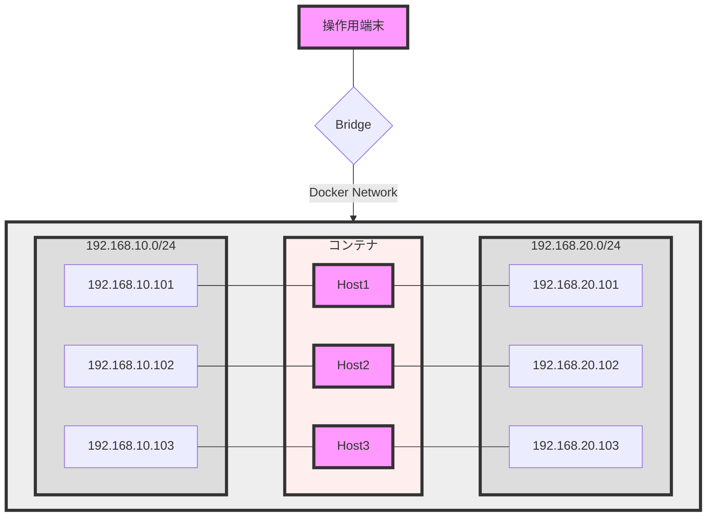

<!-- title: 個人サイトのリニューアル -->

## 10年くらい放置したままだった

思い出したタイミングでリニューアルしました。

これまでは単なる備忘録でしたが、Garminのトレーニングデータの可視化も追加するようにします。

※ 以下は、動作確認目的で色んなデータを掲載しています。

```js
const ISSUE_URL = 'https://github.com/JunichiWatanuki/JunichiWatanuki.github.io/issues/new';
const PUBLIC_SITE_URL = 'https://junichiwatanuki.github.io/';
// Keep a margin below common URL length limits, including proxies and browsers.
const MAX_PREFILLED_URL_LENGTH = 6000;

function initComments(section) {
  const form = section.querySelector('[data-comment-form]');
  const fields = section.querySelector('[data-comment-fields]');
  const title = form.querySelector('[name="title"]');
  const body = form.querySelector('[name="comment_body"]');
  const fallback = form.querySelector('[data-comment-fallback]');
  const pathInput = form.querySelector('[data-comment-path]');
  const copyStatus = form.querySelector('[data-comment-copy-status]');
  const error = form.querySelector('[data-comment-error]');
  // This path is already URL-encoded by the build; URLSearchParams encodes it
  // again for transport so GitHub receives the original encoded article URL.
  const postPath = section.dataset.commentPost || '';

  if (!/^data\/contents\/.+\.html$/i.test(postPath)) {
    error.textContent = '対象記事のパスを確認できないため、コメントフォームを利用できません。';
    error.hidden = false;
    return;
  }
  // Always use the public origin, even when this page is viewed in a preview.
  const postUrl = PUBLIC_SITE_URL + postPath;
  pathInput.value = postUrl;
  fields.disabled = false;

  for (const input of [title, body]) {
    input.addEventListener('input', () => input.setCustomValidity(''));
  }

  form.addEventListener('submit', event => {
    event.preventDefault();
    title.setCustomValidity(title.value.trim() ? '' : 'タイトルを入力してください。');
    body.setCustomValidity(body.value.trim() ? '' : 'コメントを入力してください。');
    if (!form.reportValidity()) return;

    const params = new URLSearchParams({
      template: 'comment.yaml',
      post_path: postUrl,
      title: title.value,
      comment_body: body.value
    });
    // comment.yaml applies the label; passing labels in the URL requires the
    // visitor to have label-adding permission and may otherwise result in 404.
    const url = `${ISSUE_URL}?${params.toString()}`;
    if (url.length > MAX_PREFILLED_URL_LENGTH) {
      fallback.hidden = false;
      copyStatus.textContent = '';
      return;
    }

    fallback.hidden = true;
    const link = document.createElement('a');
    link.href = url;
    link.target = '_blank';
    link.rel = 'noopener noreferrer';
    link.hidden = true;
    document.body.append(link);
    link.click();
    link.remove();
  });

  const copyFields = { title, path: pathInput, body };
  for (const button of form.querySelectorAll('[data-comment-copy]')) {
    button.addEventListener('click', async () => {
      const input = copyFields[button.dataset.commentCopy];
      if (!input) return;
      try {
        if (!navigator.clipboard || !navigator.clipboard.writeText) throw new Error('Clipboard unavailable');
        await navigator.clipboard.writeText(input.value);
        copyStatus.textContent = 'コピーしました。GitHubの該当欄に貼り付けてください。';
      } catch {
        input.focus();
        input.select();
        copyStatus.textContent = 'テキストを選択しました。コピー操作をして、GitHubの該当欄に貼り付けてください。';
      }
    });
  }
}

document.querySelectorAll('[data-comment-post]').forEach(initComments);
```


```md
# hogefuga
## hogehoge
### fugafuga
```


```svg
<svg xmlns="http://www.w3.org/2000/svg" viewBox="0 0 595.281 841.891"><path fill="#B4B4B5" d="M294.256 732.104a38.273 38.273 0 01-17.806-4.041L17.904 588.803A36.99 36.99 0 010 558.809V246.714a33.672 33.672 0 0119.153-28.943L262.62 113.203a49.29 49.29 0 0118.89-3.286 47.723 47.723 0 0116.426 2.661l277.765 105.817a32.262 32.262 0 0119.711 28.417v312.095a36.566 36.566 0 01-18.068 29.896L311.537 728.26a38.062 38.062 0 01-17.379 3.877l.098-.033z"/><path fill="#F7F7F7" d="M573.369 224.342L295.604 118.525a46.813 46.813 0 00-30.454.625L21.683 223.717a27.101 27.101 0 00-15.079 22.997v312.095a30.355 30.355 0 0014.455 24.212l258.546 139.261a34.659 34.659 0 0029.008 0l265.576-139.556a29.966 29.966 0 0014.555-24.081V246.55a25.727 25.727 0 00-15.375-22.208z"/><path fill="#E5E5E6" d="M287.193 471.784V406.08a29.568 29.568 0 00-13.7-23.785l-5.749-3.121-38.174-20.565-10.808-5.815L27.136 249.572c-7.523-4.041-13.699 0-13.699 9.034v295.669a29.567 29.567 0 0013.699 23.785l5.749 3.088 128.518 69.22 16.426 8.804 91.789 49.278 4.041 2.168c7.523 4.041 13.699 0 13.699-9.067v-65.704c0-.689 0-1.38-.164-2.069V589.69c.184-1.029.271-2.074.263-3.121v-65.704a23.042 23.042 0 00-.46-4.205v-40.77c.244-1.354.31-2.735.196-4.106z"/><path fill="#EEEEEF" d="M567.783 249.539l-36.564 19.219-159.99 84.036-5.584 2.924-40.245 21.156-10.283 5.42a29.567 29.567 0 00-14.027 23.785v295.668c0 9.035 6.309 13.142 14.027 9.067l10.283-5.42 242.383-127.335a29.567 29.567 0 0014.027-23.785V258.606c-.131-9.034-6.437-13.107-14.027-9.067z"/><path fill="#FFF" d="M556.548 223.685l-65.705-25.198-90.902-34.921-13.633-5.224-41.23-15.835-36.826-14.192-10.48-4.008-4.665-1.807a37.452 37.452 0 00-24.541.361l-49.081 21.157-37.878 16.426-52.136 22.471-86.369 37.254-9.396 4.041c-7.786 3.285-9.034 8.903-2.694 12.32l7.26 3.909 27.432 14.816 13.141 7.129 67.577 36.466 24.771 13.371 105.127 56.768a38.045 38.045 0 0031.735.625l8.344-4.37 105.752-55.487 45.992-24.113 40.508-21.321 3.021-1.577 42.707-22.372 6.572-3.285c7.029-3.812 4.992-9.791-4.403-13.404z"/><path fill="#E50012" d="M335.025 258.212c-22.471 11.071-59.527 11.564-82.688 1.084s-23.457-27.958-.723-38.93c22.733-10.973 59.43-11.268 82.327-.854 22.898 10.414 23.424 27.826 1.084 38.7z"/><path fill="#231815" d="M114.424 397.801c0 14.98-10.184 21.649-22.733 14.915-12.55-6.735-22.701-24.278-22.701-39.226s10.151-21.649 22.701-14.948c12.549 6.702 22.733 24.278 22.733 39.259zm111.993 193.137c0 15.046-10.283 21.683-22.997 14.816-12.713-6.866-22.996-24.573-22.996-39.423 0-14.849 10.25-21.649 22.996-14.849 12.747 6.801 22.997 24.377 22.997 39.456zM398.726 427.27c0 15.177-10.414 33.114-23.26 40.079-12.844 6.965-23.16.328-23.16-14.816s10.381-33.049 23.16-40.047c12.78-6.998 23.26-.395 23.26 14.784zm66.656 42.345c0 15.244-10.512 33.279-23.488 40.211s-23.424.23-23.424-14.947 10.48-33.181 23.424-40.179c12.943-6.997 23.488-.393 23.488 14.915zm67.414 42.741c0 15.342-10.645 33.41-23.752 40.342-13.109 6.932-23.654 0-23.654-15.111 0-15.112 10.578-33.313 23.654-40.31 13.075-6.998 23.752-.263 23.752 15.079z"/></svg>
```


```rawsvg
<svg xmlns="http://www.w3.org/2000/svg" viewBox="0 0 595.281 841.891"><path fill="#B4B4B5" d="M294.256 732.104a38.273 38.273 0 01-17.806-4.041L17.904 588.803A36.99 36.99 0 010 558.809V246.714a33.672 33.672 0 0119.153-28.943L262.62 113.203a49.29 49.29 0 0118.89-3.286 47.723 47.723 0 0116.426 2.661l277.765 105.817a32.262 32.262 0 0119.711 28.417v312.095a36.566 36.566 0 01-18.068 29.896L311.537 728.26a38.062 38.062 0 01-17.379 3.877l.098-.033z"/><path fill="#F7F7F7" d="M573.369 224.342L295.604 118.525a46.813 46.813 0 00-30.454.625L21.683 223.717a27.101 27.101 0 00-15.079 22.997v312.095a30.355 30.355 0 0014.455 24.212l258.546 139.261a34.659 34.659 0 0029.008 0l265.576-139.556a29.966 29.966 0 0014.555-24.081V246.55a25.727 25.727 0 00-15.375-22.208z"/><path fill="#E5E5E6" d="M287.193 471.784V406.08a29.568 29.568 0 00-13.7-23.785l-5.749-3.121-38.174-20.565-10.808-5.815L27.136 249.572c-7.523-4.041-13.699 0-13.699 9.034v295.669a29.567 29.567 0 0013.699 23.785l5.749 3.088 128.518 69.22 16.426 8.804 91.789 49.278 4.041 2.168c7.523 4.041 13.699 0 13.699-9.067v-65.704c0-.689 0-1.38-.164-2.069V589.69c.184-1.029.271-2.074.263-3.121v-65.704a23.042 23.042 0 00-.46-4.205v-40.77c.244-1.354.31-2.735.196-4.106z"/><path fill="#EEEEEF" d="M567.783 249.539l-36.564 19.219-159.99 84.036-5.584 2.924-40.245 21.156-10.283 5.42a29.567 29.567 0 00-14.027 23.785v295.668c0 9.035 6.309 13.142 14.027 9.067l10.283-5.42 242.383-127.335a29.567 29.567 0 0014.027-23.785V258.606c-.131-9.034-6.437-13.107-14.027-9.067z"/><path fill="#FFF" d="M556.548 223.685l-65.705-25.198-90.902-34.921-13.633-5.224-41.23-15.835-36.826-14.192-10.48-4.008-4.665-1.807a37.452 37.452 0 00-24.541.361l-49.081 21.157-37.878 16.426-52.136 22.471-86.369 37.254-9.396 4.041c-7.786 3.285-9.034 8.903-2.694 12.32l7.26 3.909 27.432 14.816 13.141 7.129 67.577 36.466 24.771 13.371 105.127 56.768a38.045 38.045 0 0031.735.625l8.344-4.37 105.752-55.487 45.992-24.113 40.508-21.321 3.021-1.577 42.707-22.372 6.572-3.285c7.029-3.812 4.992-9.791-4.403-13.404z"/><path fill="#E50012" d="M335.025 258.212c-22.471 11.071-59.527 11.564-82.688 1.084s-23.457-27.958-.723-38.93c22.733-10.973 59.43-11.268 82.327-.854 22.898 10.414 23.424 27.826 1.084 38.7z"/><path fill="#231815" d="M114.424 397.801c0 14.98-10.184 21.649-22.733 14.915-12.55-6.735-22.701-24.278-22.701-39.226s10.151-21.649 22.701-14.948c12.549 6.702 22.733 24.278 22.733 39.259zm111.993 193.137c0 15.046-10.283 21.683-22.997 14.816-12.713-6.866-22.996-24.573-22.996-39.423 0-14.849 10.25-21.649 22.996-14.849 12.747 6.801 22.997 24.377 22.997 39.456zM398.726 427.27c0 15.177-10.414 33.114-23.26 40.079-12.844 6.965-23.16.328-23.16-14.816s10.381-33.049 23.16-40.047c12.78-6.998 23.26-.395 23.26 14.784zm66.656 42.345c0 15.244-10.512 33.279-23.488 40.211s-23.424.23-23.424-14.947 10.48-33.181 23.424-40.179c12.943-6.997 23.488-.393 23.488 14.915zm67.414 42.741c0 15.342-10.645 33.41-23.752 40.342-13.109 6.932-23.654 0-23.654-15.111 0-15.112 10.578-33.313 23.654-40.31 13.075-6.998 23.752-.263 23.752 15.079z"/></svg>
```

```youtube
https://www.youtube.com/watch?v=B74K2b7IZDw
```

```instagram
https://www.instagram.com/p/DS4OOh9CXo0/
```

```instagram
https://www.instagram.com/junichi.watanuki/p/DdN-lNLCWtm/?img_index=7
```

```twitter
https://x.com/j_watanuki/status/2107102704682344583
```

```garmin
https://connect.garmin.com/app/activity/25084785219
```

```slideshare
https://www.slideshare.net/slideshow/ss-41306350/41306350
```

```rawhtml
  <h1 id="myText">こんにちは！</h1>
  <button id="myButton">ボタンを押してね</button>

  <script>
    // 要素を取得する
    const textElement = document.getElementById('myText');
    const buttonElement = document.getElementById('myButton');

    // ボタンがクリックされたときの処理
    buttonElement.addEventListener('click', () => {
      textElement.textContent = 'ボタンが押されました！';
    });
  </script>
```


```stl
solid STLB ATF 2.0.0.9000 COLOR=����                                                  
 facet normal 0 -1 0
  outer loop
   vertex 0 0 -23.670000076293945
   vertex 20.498821258544922 0 11.835000038146973
   vertex -20.498821258544922 0 11.835000038146973
  endloop
 endfacet
 facet normal 0.816511631011963 0.333284080028534 -0.471413224935532
  outer loop
   vertex 20.498821258544922 0 11.835000038146973
   vertex 0 0 -23.670000076293945
   vertex 0 33.479999542236328 0
  endloop
 endfacet
 facet normal -0.816511631011963 0.333284080028534 -0.471413224935532
  outer loop
   vertex 0 0 -23.670000076293945
   vertex -20.498821258544922 0 11.835000038146973
   vertex 0 33.479999542236328 0
  endloop
 endfacet
 facet normal -0 0.333284080028534 0.942826449871063
  outer loop
   vertex -20.498821258544922 0 11.835000038146973
   vertex 20.498821258544922 0 11.835000038146973
   vertex 0 33.479999542236328 0
  endloop
 endfacet
endsolid
```


```rawstl
solid STLB ATF 2.0.0.9000 COLOR=����                                                  
 facet normal 1 0 0
  outer loop
   vertex 14.5 0 14.5
   vertex 14.5 0 -14.5
   vertex 14.5 29 14.5
  endloop
 endfacet
 facet normal 1 0 0
  outer loop
   vertex 14.5 29 14.5
   vertex 14.5 0 -14.5
   vertex 14.5 29 -14.5
  endloop
 endfacet
 facet normal 0 0 1
  outer loop
   vertex -14.5 0 14.5
   vertex 14.5 0 14.5
   vertex -14.5 29 14.5
  endloop
 endfacet
 facet normal 0 0 1
  outer loop
   vertex -14.5 29 14.5
   vertex 14.5 0 14.5
   vertex 14.5 29 14.5
  endloop
 endfacet
 facet normal -1 0 0
  outer loop
   vertex -14.5 0 -14.5
   vertex -14.5 0 14.5
   vertex -14.5 29 -14.5
  endloop
 endfacet
 facet normal -1 0 0
  outer loop
   vertex -14.5 29 -14.5
   vertex -14.5 0 14.5
   vertex -14.5 29 14.5
  endloop
 endfacet
 facet normal 0 0 -1
  outer loop
   vertex 14.5 0 -14.5
   vertex -14.5 0 -14.5
   vertex 14.5 29 -14.5
  endloop
 endfacet
 facet normal 0 0 -1
  outer loop
   vertex 14.5 29 -14.5
   vertex -14.5 0 -14.5
   vertex -14.5 29 -14.5
  endloop
 endfacet
 facet normal 0 1 0
  outer loop
   vertex -14.5 29 -14.5
   vertex -14.5 29 14.5
   vertex 14.5 29 -14.5
  endloop
 endfacet
 facet normal 0 1 0
  outer loop
   vertex 14.5 29 -14.5
   vertex -14.5 29 14.5
   vertex 14.5 29 14.5
  endloop
 endfacet
 facet normal 0 -1 0
  outer loop
   vertex -14.5 0 -14.5
   vertex 14.5 0 -14.5
   vertex -14.5 0 14.5
  endloop
 endfacet
 facet normal 0 -1 0
  outer loop
   vertex -14.5 0 14.5
   vertex 14.5 0 -14.5
   vertex 14.5 0 14.5
  endloop
 endfacet
endsolid
```


```stl
solid STLB ATF 2.0.0.9000 COLOR=����                                                  
 facet normal 0 0.5734623670578 0.819231927394867
  outer loop
   vertex 17.5 0 17.5
   vertex 0 25 0
   vertex -17.5 0 17.5
  endloop
 endfacet
 facet normal 0.819231927394867 0.5734623670578 0
  outer loop
   vertex 17.5 0 17.5
   vertex 17.5 0 -17.5
   vertex 0 25 0
  endloop
 endfacet
 facet normal 0 -0.577330648899078 0.816510438919067
  outer loop
   vertex -17.5 0 17.5
   vertex 0 -24.75 0
   vertex 17.5 0 17.5
  endloop
 endfacet
 facet normal -0.819231927394867 0.5734623670578 0
  outer loop
   vertex -17.5 0 17.5
   vertex 0 25 0
   vertex -17.5 0 -17.5
  endloop
 endfacet
 facet normal 0 0.5734623670578 -0.819231927394867
  outer loop
   vertex -17.5 0 -17.5
   vertex 0 25 0
   vertex 17.5 0 -17.5
  endloop
 endfacet
 facet normal 0.816510438919067 -0.577330648899078 0
  outer loop
   vertex 17.5 0 -17.5
   vertex 17.5 0 17.5
   vertex 0 -24.75 0
  endloop
 endfacet
 facet normal -0.816510438919067 -0.577330648899078 0
  outer loop
   vertex -17.5 0 -17.5
   vertex 0 -24.75 0
   vertex -17.5 0 17.5
  endloop
 endfacet
 facet normal 0 -0.577330648899078 -0.816510438919067
  outer loop
   vertex 0 -24.75 0
   vertex -17.5 0 -17.5
   vertex 17.5 0 -17.5
  endloop
 endfacet
endsolid

```


```rawstl
solid STLB ATF 2.0.0.9000 COLOR=����                                                  
 facet normal 0 1 0
  outer loop
   vertex 0 40.080001831054688 15.310000419616699
   vertex 14.560675621032715 40.080001831054688 4.73105001449585
   vertex -14.560675621032715 40.080001831054688 4.73105001449585
  endloop
 endfacet
 facet normal 0 1 0
  outer loop
   vertex -14.560675621032715 40.080001831054688 4.73105001449585
   vertex 14.560675621032715 40.080001831054688 4.73105001449585
   vertex -8.998991966247559 40.080001831054688 -12.386050224304199
  endloop
 endfacet
 facet normal 0 1 0
  outer loop
   vertex -8.998991966247559 40.080001831054688 -12.386050224304199
   vertex 14.560675621032715 40.080001831054688 4.73105001449585
   vertex 8.998991966247559 40.080001831054688 -12.386050224304199
  endloop
 endfacet
 facet normal 0 -1 0
  outer loop
   vertex 0 24.770000457763672 24.770000457763672
   vertex -23.557670593261719 24.770000457763672 7.654350757598877
   vertex 23.557670593261719 24.770000457763672 7.654350757598877
  endloop
 endfacet
 facet normal 0 -1 0
  outer loop
   vertex 23.557670593261719 24.770000457763672 7.654350757598877
   vertex -23.557670593261719 24.770000457763672 7.654350757598877
   vertex -14.559440612792969 24.770000457763672 -20.039350509643555
  endloop
 endfacet
 facet normal 0 -1 0
  outer loop
   vertex 23.557670593261719 24.770000457763672 7.654350757598877
   vertex -14.559440612792969 24.770000457763672 -20.039350509643555
   vertex 14.559440612792969 24.770000457763672 -20.039350509643555
  endloop
 endfacet
 facet normal -0.525754451751709 0.447134166955948 0.723638892173767
  outer loop
   vertex -23.557670593261719 24.770000457763672 7.654350757598877
   vertex 0 24.770000457763672 24.770000457763672
   vertex -14.560675621032715 40.080001831054688 4.73105001449585
  endloop
 endfacet
 facet normal -0.525754451751709 0.447134166955948 0.723638892173767
  outer loop
   vertex -14.560675621032715 40.080001831054688 4.73105001449585
   vertex 0 24.770000457763672 24.770000457763672
   vertex 0 40.080001831054688 15.310000419616699
  endloop
 endfacet
 facet normal 0.525754451751709 0.447134166955948 0.723638892173767
  outer loop
   vertex 0 24.770000457763672 24.770000457763672
   vertex 23.557670593261719 24.770000457763672 7.654350757598877
   vertex 0 40.080001831054688 15.310000419616699
  endloop
 endfacet
 facet normal 0.525754451751709 0.447134166955948 0.723638892173767
  outer loop
   vertex 0 40.080001831054688 15.310000419616699
   vertex 23.557670593261719 24.770000457763672 7.654350757598877
   vertex 14.560675621032715 40.080001831054688 4.73105001449585
  endloop
 endfacet
 facet normal 0.850688576698303 0.447134166955948 -0.276405483484268
  outer loop
   vertex 23.557670593261719 24.770000457763672 7.654350757598877
   vertex 14.559440612792969 24.770000457763672 -20.039350509643555
   vertex 14.560675621032715 40.080001831054688 4.73105001449585
  endloop
 endfacet
 facet normal 0.850688576698303 0.447134166955948 -0.276405483484268
  outer loop
   vertex 14.560675621032715 40.080001831054688 4.73105001449585
   vertex 14.559440612792969 24.770000457763672 -20.039350509643555
   vertex 8.998991966247559 40.080001831054688 -12.386050224304199
  endloop
 endfacet
 facet normal 0 0.447134166955948 -0.894466876983643
  outer loop
   vertex 14.559440612792969 24.770000457763672 -20.039350509643555
   vertex -14.559440612792969 24.770000457763672 -20.039350509643555
   vertex 8.998991966247559 40.080001831054688 -12.386050224304199
  endloop
 endfacet
 facet normal 0 0.447134166955948 -0.894466876983643
  outer loop
   vertex 8.998991966247559 40.080001831054688 -12.386050224304199
   vertex -14.559440612792969 24.770000457763672 -20.039350509643555
   vertex -8.998991966247559 40.080001831054688 -12.386050224304199
  endloop
 endfacet
 facet normal -0.850688576698303 0.447134166955948 -0.276405483484268
  outer loop
   vertex -14.559440612792969 24.770000457763672 -20.039350509643555
   vertex -23.557670593261719 24.770000457763672 7.654350757598877
   vertex -8.998991966247559 40.080001831054688 -12.386050224304199
  endloop
 endfacet
 facet normal -0.850688576698303 0.447134166955948 -0.276405483484268
  outer loop
   vertex -8.998991966247559 40.080001831054688 -12.386050224304199
   vertex -23.557670593261719 24.770000457763672 7.654350757598877
   vertex -14.560675621032715 40.080001831054688 4.73105001449585
  endloop
 endfacet
 facet normal 0 -1 0
  outer loop
   vertex 0 0 -15.310000419616699
   vertex 14.560675621032715 0 -4.73105001449585
   vertex -14.560675621032715 0 -4.73105001449585
  endloop
 endfacet
 facet normal 0 -1 0
  outer loop
   vertex -14.560675621032715 0 -4.73105001449585
   vertex 14.560675621032715 0 -4.73105001449585
   vertex -8.998991966247559 0 12.386050224304199
  endloop
 endfacet
 facet normal 0 -1 0
  outer loop
   vertex -8.998991966247559 0 12.386050224304199
   vertex 14.560675621032715 0 -4.73105001449585
   vertex 8.998991966247559 0 12.386050224304199
  endloop
 endfacet
 facet normal 0 1 0
  outer loop
   vertex 0 15.310000419616699 -24.770000457763672
   vertex -23.557670593261719 15.310000419616699 -7.654350757598877
   vertex 23.557670593261719 15.310000419616699 -7.654350757598877
  endloop
 endfacet
 facet normal 0 1 0
  outer loop
   vertex 23.557670593261719 15.310000419616699 -7.654350757598877
   vertex -23.557670593261719 15.310000419616699 -7.654350757598877
   vertex -14.559440612792969 15.310000419616699 20.039350509643555
  endloop
 endfacet
 facet normal 0 1 0
  outer loop
   vertex 23.557670593261719 15.310000419616699 -7.654350757598877
   vertex -14.559440612792969 15.310000419616699 20.039350509643555
   vertex 14.559440612792969 15.310000419616699 20.039350509643555
  endloop
 endfacet
 facet normal 0.525754451751709 -0.447134166955948 -0.723638892173767
  outer loop
   vertex 0 15.310000419616699 -24.770000457763672
   vertex 23.557670593261719 15.310000419616699 -7.654350757598877
   vertex 0 0 -15.310000419616699
  endloop
 endfacet
 facet normal 0.525754451751709 -0.447134166955948 -0.723638892173767
  outer loop
   vertex 0 0 -15.310000419616699
   vertex 23.557670593261719 15.310000419616699 -7.654350757598877
   vertex 14.560675621032715 0 -4.73105001449585
  endloop
 endfacet
 facet normal -0.525754451751709 -0.447134166955948 -0.723638892173767
  outer loop
   vertex -23.557670593261719 15.310000419616699 -7.654350757598877
   vertex 0 15.310000419616699 -24.770000457763672
   vertex -14.560675621032715 0 -4.73105001449585
  endloop
 endfacet
 facet normal -0.525754451751709 -0.447134166955948 -0.723638892173767
  outer loop
   vertex -14.560675621032715 0 -4.73105001449585
   vertex 0 15.310000419616699 -24.770000457763672
   vertex 0 0 -15.310000419616699
  endloop
 endfacet
 facet normal -0.850688576698303 -0.447134166955948 0.276405483484268
  outer loop
   vertex -14.559440612792969 15.310000419616699 20.039350509643555
   vertex -23.557670593261719 15.310000419616699 -7.654350757598877
   vertex -8.998991966247559 0 12.386050224304199
  endloop
 endfacet
 facet normal -0.850688576698303 -0.447134166955948 0.276405483484268
  outer loop
   vertex -8.998991966247559 0 12.386050224304199
   vertex -23.557670593261719 15.310000419616699 -7.654350757598877
   vertex -14.560675621032715 0 -4.73105001449585
  endloop
 endfacet
 facet normal 0 -0.447134166955948 0.894466876983643
  outer loop
   vertex 14.559440612792969 15.310000419616699 20.039350509643555
   vertex -14.559440612792969 15.310000419616699 20.039350509643555
   vertex 8.998991966247559 0 12.386050224304199
  endloop
 endfacet
 facet normal -0 -0.447134166955948 0.894466876983643
  outer loop
   vertex 8.998991966247559 0 12.386050224304199
   vertex -14.559440612792969 15.310000419616699 20.039350509643555
   vertex -8.998991966247559 0 12.386050224304199
  endloop
 endfacet
 facet normal 0.850688576698303 -0.447134166955948 0.276405483484268
  outer loop
   vertex 23.557670593261719 15.310000419616699 -7.654350757598877
   vertex 14.559440612792969 15.310000419616699 20.039350509643555
   vertex 14.560675621032715 0 -4.73105001449585
  endloop
 endfacet
 facet normal 0.850688576698303 -0.447134166955948 0.276405483484268
  outer loop
   vertex 14.560675621032715 0 -4.73105001449585
   vertex 14.559440612792969 15.310000419616699 20.039350509643555
   vertex 8.998991966247559 0 12.386050224304199
  endloop
 endfacet
 facet normal -0 1 -0
  outer loop
   vertex -14.559440612792969 24.770000457763672 -20.039350509643555
   vertex -23.557670593261719 24.770000457763672 7.654350757598877
   vertex 14.559440612792969 24.770000457763672 -20.039350509643555
  endloop
 endfacet
 facet normal -0 1 -0
  outer loop
   vertex 14.559440612792969 24.770000457763672 -20.039350509643555
   vertex -23.557670593261719 24.770000457763672 7.654350757598877
   vertex -0.000000000000004 24.770000457763672 24.770000457763672
  endloop
 endfacet
 facet normal 0 1 0
  outer loop
   vertex 14.559440612792969 24.770000457763672 -20.039350509643555
   vertex -0.000000000000004 24.770000457763672 24.770000457763672
   vertex 23.557670593261719 24.770000457763672 7.654350757598877
  endloop
 endfacet
 facet normal 0.850621223449707 -0.447290569543839 0.276359766721725
  outer loop
   vertex 14.559440612792969 15.310000419616699 20.039350509643555
   vertex 23.557170867919922 15.31020450592041 -7.654868125915527
   vertex 23.557670593261719 24.770000457763672 7.654350757598877
  endloop
 endfacet
 facet normal 0.85063511133194 0.447246581315994 -0.276388108730316
  outer loop
   vertex 23.557670593261719 24.770000457763672 7.654350757598877
   vertex 23.557170867919922 15.31020450592041 -7.654868125915527
   vertex 14.559440612792969 24.770000457763672 -20.039350509643555
  endloop
 endfacet
 facet normal 0.525716364383698 -0.447261840105057 -0.723587691783905
  outer loop
   vertex 23.557170867919922 15.31020450592041 -7.654868125915527
   vertex 0 15.310000419616699 -24.770000457763672
   vertex 14.559440612792969 24.770000457763672 -20.039350509643555
  endloop
 endfacet
 facet normal -0 0.447262674570084 -0.894402623176575
  outer loop
   vertex 14.559440612792969 24.770000457763672 -20.039350509643555
   vertex 0 15.310000419616699 -24.770000457763672
   vertex -14.559440612792969 24.770000457763672 -20.039350509643555
  endloop
 endfacet
 facet normal -0.525716662406921 -0.447262674570084 -0.723586916923523
  outer loop
   vertex 0 15.310000419616699 -24.770000457763672
   vertex -23.557670593261719 15.310000419616699 -7.654350757598877
   vertex -14.559440612792969 24.770000457763672 -20.039350509643555
  endloop
 endfacet
 facet normal 0.525716662406921 0.447262674570084 0.723586916923523
  outer loop
   vertex 23.557670593261719 24.770000457763672 7.654350757598877
   vertex -0.000000000000004 24.770000457763672 24.770000457763672
   vertex 14.559440612792969 15.310000419616699 20.039350509643555
  endloop
 endfacet
 facet normal -0 -0.447262674570084 0.894402623176575
  outer loop
   vertex -14.559440612792969 15.310000419616699 20.039350509643555
   vertex 14.559440612792969 15.310000419616699 20.039350509643555
   vertex -0.000000000000004 24.770000457763672 24.770000457763672
  endloop
 endfacet
 facet normal -0.850627481937408 0.447262674570084 -0.276385605335236
  outer loop
   vertex -23.557670593261719 15.310000419616699 -7.654350757598877
   vertex -23.557670593261719 24.770000457763672 7.654350757598877
   vertex -14.559440612792969 24.770000457763672 -20.039350509643555
  endloop
 endfacet
 facet normal -0.850627481937408 -0.447262674570084 0.276385605335236
  outer loop
   vertex -23.557670593261719 24.770000457763672 7.654350757598877
   vertex -23.557670593261719 15.310000419616699 -7.654350757598877
   vertex -14.559440612792969 15.310000419616699 20.039350509643555
  endloop
 endfacet
 facet normal -0.525716662406921 0.447262674570084 0.723586916923523
  outer loop
   vertex -14.559440612792969 15.310000419616699 20.039350509643555
   vertex -0.000000000000004 24.770000457763672 24.770000457763672
   vertex -23.557670593261719 24.770000457763672 7.654350757598877
  endloop
 endfacet
 facet normal 0.000004343776254 -1 0.000005978695299
  outer loop
   vertex 0 15.310000419616699 -24.770000457763672
   vertex 23.557170867919922 15.31020450592041 -7.654868125915527
   vertex -23.557670593261719 15.310000419616699 -7.654350757598877
  endloop
 endfacet
 facet normal 0.000004343695309 -1 -0.000001411352059
  outer loop
   vertex -23.557670593261719 15.310000419616699 -7.654350757598877
   vertex 23.557170867919922 15.31020450592041 -7.654868125915527
   vertex -14.559440612792969 15.310000419616699 20.039350509643555
  endloop
 endfacet
 facet normal -0 -1 -0.000007389745406
  outer loop
   vertex -14.559440612792969 15.310000419616699 20.039350509643555
   vertex 23.557170867919922 15.31020450592041 -7.654868125915527
   vertex 14.559440612792969 15.310000419616699 20.039350509643555
  endloop
 endfacet
endsolid

```


```stl
solid STLB ATF 2.0.0.9000 COLOR=����                                                  
 facet normal 0 0.794673979282379 -0.607036411762238
  outer loop
   vertex 13.001810073852539 22.100000381469727 -17.895456314086914
   vertex -13.001810073852539 22.100000381469727 -17.895456314086914
   vertex 0 35.770000457763672 0
  endloop
 endfacet
 facet normal -0.934142589569092 0.187756255269051 -0.303521335124969
  outer loop
   vertex -21.037370681762695 22.100000381469727 6.835455894470215
   vertex -13.001810073852539 22.100000381469727 -17.895456314086914
   vertex -21.037370681762695 0 -6.835455894470215
  endloop
 endfacet
 facet normal -0.577325940132141 0.794673979282379 -0.187584578990936
  outer loop
   vertex -21.037370681762695 22.100000381469727 6.835455894470215
   vertex 0 35.770000457763672 0
   vertex -13.001810073852539 22.100000381469727 -17.895456314086914
  endloop
 endfacet
 facet normal 0 0.187756255269051 -0.982215642929077
  outer loop
   vertex 13.001810073852539 22.100000381469727 -17.895456314086914
   vertex 0 0 -22.120000839233398
   vertex -13.001810073852539 22.100000381469727 -17.895456314086914
  endloop
 endfacet
 facet normal 0.577325940132141 0.794673979282379 -0.187584578990936
  outer loop
   vertex 13.001810073852539 22.100000381469727 -17.895456314086914
   vertex 0 35.770000457763672 0
   vertex 21.037370681762695 22.100000381469727 6.835455894470215
  endloop
 endfacet
 facet normal -0.356807053089142 0.794673979282379 0.491102784872055
  outer loop
   vertex 0 22.100000381469727 22.120000839233398
   vertex 0 35.770000457763672 0
   vertex -21.037370681762695 22.100000381469727 6.835455894470215
  endloop
 endfacet
 facet normal -0.577331900596619 -0.187756255269051 -0.794629156589508
  outer loop
   vertex -21.037370681762695 0 -6.835455894470215
   vertex -13.001810073852539 22.100000381469727 -17.895456314086914
   vertex 0 0 -22.120000839233398
  endloop
 endfacet
 facet normal 0.356807053089142 0.794673979282379 0.491102784872055
  outer loop
   vertex 21.037370681762695 22.100000381469727 6.835455894470215
   vertex 0 35.770000457763672 0
   vertex 0 22.100000381469727 22.120000839233398
  endloop
 endfacet
 facet normal 0.577331900596619 -0.187756255269051 -0.794629156589508
  outer loop
   vertex 0 0 -22.120000839233398
   vertex 13.001810073852539 22.100000381469727 -17.895456314086914
   vertex 21.037370681762695 0 -6.835455894470215
  endloop
 endfacet
 facet normal -0.577325940132141 -0.794673979282379 0.187584578990936
  outer loop
   vertex -13.001810073852539 0 17.895456314086914
   vertex -21.037370681762695 0 -6.835455894470215
   vertex 0 -13.670000076293945 0
  endloop
 endfacet
 facet normal -0.356807053089142 -0.794673979282379 -0.491102784872055
  outer loop
   vertex 0 -13.670000076293945 0
   vertex -21.037370681762695 0 -6.835455894470215
   vertex 0 0 -22.120000839233398
  endloop
 endfacet
 facet normal -0.934142589569092 -0.187756255269051 0.303521335124969
  outer loop
   vertex -13.001810073852539 0 17.895456314086914
   vertex -21.037370681762695 22.100000381469727 6.835455894470215
   vertex -21.037370681762695 0 -6.835455894470215
  endloop
 endfacet
 facet normal 0.356807053089142 -0.794673979282379 -0.491102784872055
  outer loop
   vertex 0 0 -22.120000839233398
   vertex 21.037370681762695 0 -6.835455894470215
   vertex 0 -13.670000076293945 0
  endloop
 endfacet
 facet normal -0.577331900596619 0.187756255269051 0.794629156589508
  outer loop
   vertex -13.001810073852539 0 17.895456314086914
   vertex 0 22.100000381469727 22.120000839233398
   vertex -21.037370681762695 22.100000381469727 6.835455894470215
  endloop
 endfacet
 facet normal 0.577331900596619 0.187756255269051 0.794629156589508
  outer loop
   vertex 21.037370681762695 22.100000381469727 6.835455894470215
   vertex 0 22.100000381469727 22.120000839233398
   vertex 13.001810073852539 0 17.895456314086914
  endloop
 endfacet
 facet normal -0 -0.187756255269051 0.982215642929077
  outer loop
   vertex -13.001810073852539 0 17.895456314086914
   vertex 13.001810073852539 0 17.895456314086914
   vertex 0 22.100000381469727 22.120000839233398
  endloop
 endfacet
 facet normal 0.934142589569092 0.187756255269051 -0.303521335124969
  outer loop
   vertex 21.037370681762695 0 -6.835455894470215
   vertex 13.001810073852539 22.100000381469727 -17.895456314086914
   vertex 21.037370681762695 22.100000381469727 6.835455894470215
  endloop
 endfacet
 facet normal 0.934142589569092 -0.187756255269051 0.303521335124969
  outer loop
   vertex 21.037370681762695 22.100000381469727 6.835455894470215
   vertex 13.001810073852539 0 17.895456314086914
   vertex 21.037370681762695 0 -6.835455894470215
  endloop
 endfacet
 facet normal 0.577325940132141 -0.794673979282379 0.187584578990936
  outer loop
   vertex 21.037370681762695 0 -6.835455894470215
   vertex 13.001810073852539 0 17.895456314086914
   vertex 0 -13.670000076293945 0
  endloop
 endfacet
 facet normal -0 -0.794673979282379 0.607036411762238
  outer loop
   vertex 13.001810073852539 0 17.895456314086914
   vertex -13.001810073852539 0 17.895456314086914
   vertex 0 -13.670000076293945 0
  endloop
 endfacet
endsolid
```


# ローカル端末での環境構築  

## 動作環境のイメージ図  
※ 見た目に違和感がある理由は、新しいもの（Mermaid）で無理やり作図してみたことが原因かも。。。  




```rawmermaid
flowchart TD
  subgraph C[ ]
    direction LR
    subgraph 192.168.10.0/24
        direction TB
        N101[192.168.10.101]
        N102[192.168.10.102]
        N103[192.168.10.103]
    end
    subgraph コンテナ
        direction TB
        Host1
        Host2
        Host3
    end
    subgraph 192.168.20.0/24
        direction TB
        N201[192.168.20.101]
        N202[192.168.20.102]
        N203[192.168.20.103]
    end
  end
  A[操作用端末] --- B{Bridge}
  B{Bridge} -->|Docker Network| C
  N101 --- Host1
  N102 --- Host2
  N103 --- Host3
  Host1 --- N201
  Host2 --- N202
  Host3 --- N203

  style A fill:#f9f,stroke:#333,stroke-width:4px
  style C fill:#eee,stroke:#333,stroke-width:4px
  style 192.168.10.0/24 fill:#ddd,stroke:#333,stroke-width:4px
  style 192.168.20.0/24 fill:#ddd,stroke:#333,stroke-width:4px
  style Host1 fill:#f9f,stroke:#333,stroke-width:4px
  style Host2 fill:#f9f,stroke:#333,stroke-width:4px
  style Host3 fill:#f9f,stroke:#333,stroke-width:4px
  style コンテナ fill:#fee,stroke:#333,stroke-width:4px
```

